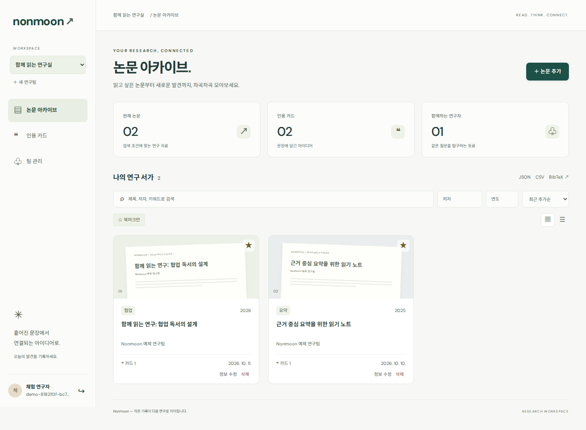
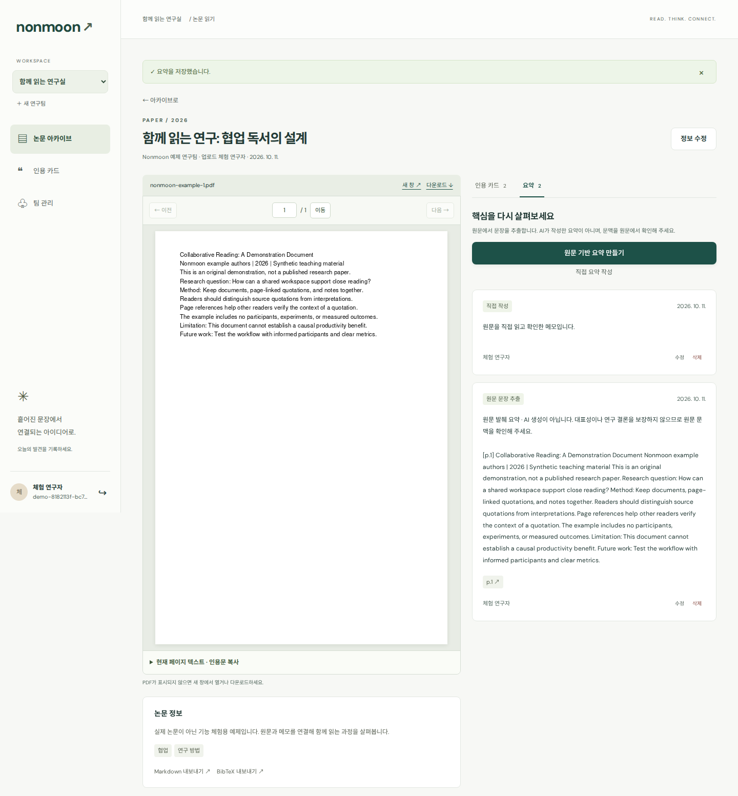

# Nonmoon · 팀 프로젝트에서 개인 개선으로

논문 PDF를 함께 읽고, 인용 카드와 요약을 기록하는 연구 공간입니다. 팀 프로젝트 제출 결과를 출발점으로 삼아 강지호가 AI와 코드 리뷰·재설계·구현·검증을 진행한 개인 개선 버전입니다.

- [원본 팀 결과물 — second-main22](https://github.com/jiho6367-design/nonmoon/tree/second-main22)
- [개인 개선 버전 — jiho/individual-improvement](https://github.com/jiho6367-design/nonmoon/tree/jiho/individual-improvement)
- [코드 리뷰](docs/CODE_REVIEW.md) · [개선 과정](docs/DEVELOPMENT_LOG.md) · [검증 결과와 한계](docs/VERIFICATION.md)
- [원본 팀 소개·역할·시연](docs/TEAM_PROJECT_README.md)



## 무엇을 개선했나

비교 기준은 `second-main22@fbd273a7207e352056d7dec590ccbac0527f2c28`입니다. 아래 원본 평가는 제출된 저장소 코드 기준이며, 당시 팀 시연이나 팀원의 기여를 평가하는 의미는 아닙니다.

| 영역 | 원본 코드에서 확인한 문제 | 개인 개선 결과 |
|---|---|---|
| 실행 | 서버 라우터·화면 진입점 등 필수 파일 누락 | 루트에서 설치·빌드·실행 가능한 단일 앱 |
| 계정·권한 | 평문 비밀번호, 자료 API의 팀 범위 검사 부재 | scrypt 해시, 서버 세션, 팀 멤버십 검사, 소유자 관리 |
| 저장 | 지연 JSON 덮어쓰기, 실패가 성공처럼 응답될 수 있음 | SQLite 트랜잭션·외래키, 재시작 유지·삭제 연쇄 처리 |
| PDF | 파일 이름만 전달하는 업로드 흐름, 공개 파일 경로 | 실제 PDF 검증·비공개 열람, 앱 내부 페이지 렌더링 |
| 카드·요약 | 논문 범위 혼동, 외부 실패가 요약으로 저장됨 | 논문별 CRUD·페이지 연결, 명확한 실패 응답과 근거 표시 |
| 사용성 | 고정 폭 화면, 오류와 빈 결과 혼동 | 모바일 대응, 검색 초기화, 상태 구분, 키보드·대비 보완 |
| 재현성 | 현재 저장소의 실행·검증 근거 부족 | lockfile, HTTP·브라우저·백업 테스트, 검증 기록 |

기존 `server/`와 `user-auth/`의 코드는 비교용으로 보존했습니다. 새 실행 경로는 `api/`와 `client/`입니다. 기존 데이터의 자동 이전은 포함하지 않습니다.

## 실행

**Node.js 24.x**를 설치하고 저장소 루트에서 실행합니다. 새 앱에는 MySQL이나 AI API 키가 필요하지 않습니다.

**Windows ZIP 사용자:** 압축을 모두 푼 뒤 최상위 `START_Windows.bat`를 더블클릭합니다. 이 파일은 자신의 폴더로 자동 이동한 다음 설치·빌드·서버 시작을 차례로 실행합니다. 서버 시작 문구가 나오면 브라우저에서 `http://localhost:4000`을 엽니다. 실행 창은 닫지 마세요.

명령을 직접 입력할 때는 `api`, `client`, `START_Windows.bat`, 루트 `package.json`이 함께 보이는 폴더를 사용합니다. `server/`와 `user-auth/`에도 예전 `package.json`이 있지만 보관용 원본이므로 그 안에서 실행하면 안 됩니다. 이미 `server>`에서 명령을 실행했다면 먼저 `cd ..`로 한 단계 위로 이동하세요.

```bash
git clone --branch jiho/individual-improvement https://github.com/jiho6367-design/nonmoon.git
cd nonmoon
npm ci
npm run build
npm start
```

[http://localhost:4000](http://localhost:4000)에 접속합니다. **체험 공간 열기**로 기능을 둘러보거나 회원가입으로 자신의 공간을 만듭니다. 체험 자료는 실제 논문이 아닌 자체 제작 예시이며 체험 세션마다 별도 공간을 만듭니다.

개발할 때는 `npm run dev`를 사용하고 [http://localhost:5173](http://localhost:5173)에 접속합니다. API 기본 포트는 4000이며 Vite가 `/api` 요청을 전달합니다. 서버 설정이 필요하면 `.env.example`을 `.env`로 복사합니다. 개발 프록시는 기본 API 포트 4000을 사용합니다.

## 사용할 수 있는 기능

- 회원가입·로그인·서버 로그아웃, 팀 생성·삭제, 가입한 동료를 이메일로 팀에 추가·제외
- PDF 업로드와 논문 정보 수정·삭제, 제목·저자·연도·태그 검색 및 개인 북마크
- 논문·인용 카드의 목록/표 보기, 카드 작성·수정·삭제, 주제·키워드·북마크 필터
- PDF 페이지 이동, 카드의 출처 페이지로 이동, 추출 가능한 페이지 본문 확인
- 논문별 발췌 요약·직접 작성 요약의 생성·수정·삭제
- 팀 자료 JSON·CSV·BibTeX 및 논문 Markdown·BibTeX 내보내기



## 요약의 처리 방식

기본 모드는 **원문 발췌**입니다. 본문을 추출할 수 있는 최대 6개 페이지를 고르게 골라 페이지당 최대 800자를 표시합니다. AI 생성 요약이나 논문 전체의 의미 분석으로 표시하지 않습니다. 스캔 PDF의 OCR은 포함하지 않으며 본문을 추출할 수 없으면 직접 요약을 작성할 수 있습니다.

선택적으로 `.env`에 `SUMMARY_PROVIDER=openai`, `OPENAI_API_KEY`, `OPENAI_MODEL`을 설정하면 발췌 본문 기반 생성 요약을 요청합니다. 이 설정에서는 외부 공급자로 본문이 전송되고 비용이 발생할 수 있습니다. 공급자 오류·빈 응답은 저장하지 않으며 요청 제한시간은 30초입니다. 실제 유료 호출과 요약 품질은 이번 검증에 포함하지 않았습니다.

## 검증과 백업

```bash
npm test
npm run build
npx playwright install chromium
npm run test:e2e
npm run format:check
```

브라우저 설치를 마친 뒤에는 `npm run verify`로 기능 테스트·빌드·브라우저 테스트를 순서대로 실행할 수 있습니다. **HTTP·백업 22개와 브라우저 시나리오 10개 통과**를 확인했습니다. 설치 환경과 수정 라운드, 테스트 범위는 [검증 기록](docs/VERIFICATION.md)에 있습니다.

자료는 기본 `.data/`의 `nonmoon.sqlite`와 `uploads/`에 저장됩니다. 앱을 종료한 뒤 `npm run backup`을 실행하면 `backups/`에 데이터베이스와 PDF를 함께 백업합니다. 복원 시 앱을 종료하고 백업의 두 항목을 `DATA_DIR`에 함께 복사합니다. 기존 자료는 복원 전에 별도 보관하세요. 계정·세션·개인 자료가 포함된 `.data/`, `.env`, `backups/`는 Git에서 제외합니다.

## 구조와 기여 범위

| 경로 | 역할 |
|---|---|
| `api/` | Express API, SQLite, 인증·팀 권한, PDF·요약 처리 |
| `client/` | React·Vite 화면과 PDF.js 리더 |
| `scripts/` | 개발 서버, 백업, 독립 브라우저 테스트 서버 |
| `tests/` | HTTP·저장·권한·백업 및 Playwright·axe 검사 |
| `docs/` | 원본 리뷰, 개선 기록, 검증 결과, 실제 화면 |
| `server/`, `user-auth/` | 수정하지 않은 원본 팀 코드 |

원본은 강지호·박예슬·김경은·임성민의 팀 프로젝트입니다. 원본의 팀원 역할과 시연은 [기존 소개](docs/TEAM_PROJECT_README.md)를 참고하세요. 개인 개선에서는 강지호의 요청에 따라 AI와 문제를 판단하고 구현·검증을 진행했습니다. 담당한 개선 범위와 AI의 도움을 받은 코드 작성 범위를 동일하게 취급하거나, 모든 코드를 독립적으로 직접 작성했다고 주장하지 않습니다.

현재 결과물은 로컬 실행과 명시된 테스트 범위를 검증한 버전입니다. 운영 서버 배포, 실제 외부 AI 품질, 대규모 동시 사용자 부하, 기존 데이터 이전은 별도 검증·작업이 필요합니다.
